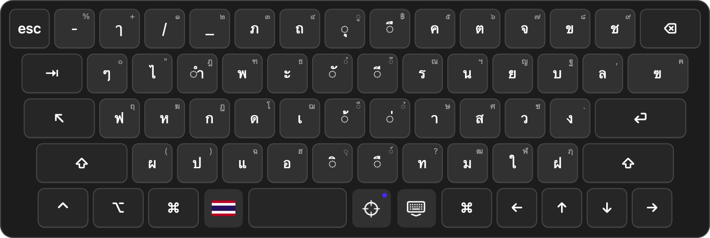

# OpenOSK Thai Touch

A compact on-screen keyboard for using a Mac with a USB touchscreen. Includes Thai Kedmanee and English, follows the active text field, and collapses into a small floating keyboard button.

**Our setup: a MacBook connected to a Promethean ActivPanel Nickel touchscreen**, using HDMI 2 for video and the adjacent USB port labelled **Touch** for touch input. This fork was developed for that classroom setup.

A fork of [OpenOSK by Christian Neff (secondtruth)](https://github.com/secondtruth/open-osk). The original project and its contributors provide the keyboard engine and accessibility features. This fork adds the Thai touchscreen workflow described below; it is not an official upstream release.

## Features

- **Thai included:** Thai Kedmanee is bundled and selected on a fresh installation. English QWERTY and the upstream German layout remain available.
- **One-tap Thai / English:** tap the 🇹🇭 / 🇺🇸 flag in the bottom row. The flag shows the current keyboard layout. OpenOSK's layout is independent of the Mac's hardware-keyboard input source.
- **Follow the text field:** the target button enables following; a blue dot means it is on. The keyboard uses macOS Accessibility geometry to sit below, above, or beside the focused field where space permits.
- **Collapse without losing follow:** tap the keyboard-with-down-arrow button. A small, touch-friendly keyboard bubble remains near the active field. Tap the bubble to expand with the same language selected.
- **Compact layout:** language, follow, and collapse controls live in the bottom row; no empty toolbar above the keys. The bubble stays visible instead of fading away.
- **Theme-aware controls:** System, Dark, Light, and High Contrast palettes apply to the added controls too.

Sticky modifiers, shortcuts, word prediction, custom panels, scanning, and the Texter companion come from upstream. The compact keyboard hides the current-text and suggestion bars. See the [upstream overview](docs/UPSTREAM_README.md) for the original feature set.

## Preview

### Full keyboard



### The “ติ่ง” — collapsed bubble


**ย่อแล้วเหลือแค่ “ติ่ง” คอยวิ่งตามช่องพิมพ์ จิ้มอีกทีก็กลับมาเป็นคีย์บอร์ดเต็ม**

The floating “ติ่ง” follows the selected text field while follow is enabled. Tap it to expand with the same language selected.

## Requirements

- macOS 13 or later.
- A touchscreen connected for **both video and USB touch**. HDMI by itself carries no touch input.
- Working touch input in macOS; OpenOSK is a keyboard, not a touchscreen driver.
- Accessibility permission for OpenOSK.
- Swift 6 / Xcode Command Line Tools to build from source.

The Thai touch workflow has been tried on an Intel Mac with macOS 15 and a Promethean ActivPanel Nickel. Compatibility with other displays and applications needs testing. The source also supports Apple Silicon; this fork has not yet been tested on Apple Silicon hardware.

## Build and install

```sh
git clone https://github.com/nasarafe/openosk-thai-touch.git
cd openosk-thai-touch
make bundle
```

Move `build/OpenOSK.app` to Applications, then open it. On first launch, allow **OpenOSK** under **System Settings → Privacy & Security → Accessibility**.

For a checkout on a synced or network volume, put build products on a local disk:

```sh
make bundle SCRATCH_PATH="$HOME/Library/Caches/OpenOSK-Thai-Touch-build"
```

This source build is ad-hoc signed and is not Apple-notarized. If macOS blocks opening it, use the system's **Open Anyway** control for the app you built. Rebuilding can invalidate the previous Accessibility grant even when its switch still looks enabled. Quit OpenOSK, remove its old Accessibility entry with **−**, add `/Applications/OpenOSK.app` again with **+**, enable it, and reopen the app.

This fork currently keeps the upstream application name and bundle identifier, so it shares settings with an existing OpenOSK installation. It is intended to replace that installation, rather than run beside it.

## Using the keyboard

| Control | Action |
| --- | --- |
| 🇹🇭 / 🇺🇸 | Switch Thai and English |
| Target icon | Toggle following; blue dot = on |
| Keyboard + down arrow | Collapse to the floating bubble |
| Floating keyboard bubble | Expand the full keyboard |
| Shift | Tap once for the shifted character, twice to lock |

Choose other layouts and settings from OpenOSK's menu-bar icon. Follow remains active while collapsed when its target toggle is on. The bubble does not automatically expand when another text field is selected.

### Follow limitations

Applications must expose editable-field geometry through macOS Accessibility. Large editors can expose the insertion line; otherwise placement uses the whole field. A field that occupies most of the display may leave no position that avoids all overlap. Secure fields and custom-rendered controls can behave differently. No guarantee is made for every application.

## Fresh-install defaults

| Setting | Default |
| --- | --- |
| Keyboard | Thai Kedmanee |
| Theme | Dark |
| Opacity | 90.64% |
| Key size | 91.95% of standard |
| Follow text field | On |
| Show automatically on text focus | On |
| Key click sound | On |
| Start collapsed | Off; subsequent collapse state is remembered |

The exact values are in [`Preferences.defaultSettings`](Sources/OpenOSKCore/Preferences.swift) and the bundled [`settings.json`](Sources/OpenOSKCore/Resources/Defaults/settings.json). Existing saved preferences take precedence; updating the app does not reset them. No personal dictionaries, application profiles, or screen coordinates are included in the repository.

## Development and checks

```sh
make build
make test
make bundle
build/OpenOSK.app/Contents/MacOS/OpenOSK --smoke-test
build/OpenOSK.app/Contents/MacOS/OpenOSK --local-ui-check /tmp/openosk-thai-touch-preview
```

`--local-ui-check` exercises the actual language, follow, minimize, and expand controls; checks compact layout bounds; tests collapsed placement with synthetic field geometry; and renders previews. It does not replace real application and touchscreen testing. It temporarily exercises keyboard preferences and restores the previous values afterward.

For all-theme and settings previews:

```sh
.build/debug/openosk --snapshot /tmp/openosk-thai-touch-themes
```

## Credits and license

Based on [secondtruth/open-osk](https://github.com/secondtruth/open-osk), copyright Christian Neff and the original contributors. The MIT license and original copyright notice are retained in [LICENSE](LICENSE). Thai touch additions are maintained in this fork.
